<p align="center">
  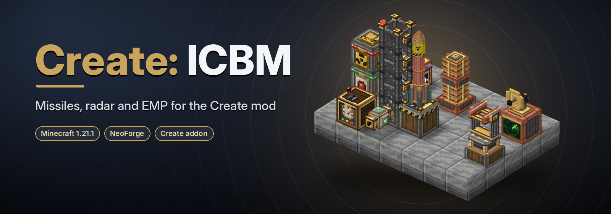
</p>

<p align="center">
  
  
  
  
  
</p>

**Create: ICBM** is an addon for [Create](https://github.com/Creators-of-Create/Create) that brings missiles,
explosives, radar and EMP towers into your factory. Launch pads are wound up by shafts, missiles are put together on
Mechanical Crafters and Deployers, explosives are mixed in basins over Blaze Burners, and every block looks like it came
out of Create itself.

It is a new addon, inspired by the classic **ICBM** mod (see [Credits](#credits)).

> **AI usage notice:** AI assistance was used in making Create: ICBM. Every feature is directed, reviewed
> and tested in game by the author.

---

## Contents

- [Features](#features)
- [Installation](#installation)
- [Your first launch](#your-first-launch)
- [Machines](#machines)
  - [Launch Pad](#launch-pad)
  - [Launch Gantry](#launch-gantry)
  - [Launch Connector](#launch-connector)
  - [Launch Controller](#launch-controller)
  - [Cruise Turret](#cruise-turret)
  - [Radar Station](#radar-station)
  - [EMP Tower](#emp-tower)
  - [EMP Coil Extender](#emp-coil-extender)
- [Missiles](#missiles)
  - [Missile Casing](#missile-casing)
  - [Missile Module](#missile-module)
  - [Explosive Missiles](#explosive-missiles)
  - [Surface to Air Missile](#surface-to-air-missile)
  - [Delivery Missile](#delivery-missile)
  - [Mail](#mail)
  - [Flight and interception](#flight-and-interception)
- [Explosives](#explosives)
  - [Tier 1](#tier-1)
  - [Tier 2](#tier-2)
  - [Tier 3](#tier-3)
  - [Tier 4](#tier-4)
- [Bomb carts](#bomb-carts)
- [Tools](#tools)
  - [Laser Range Finder](#laser-range-finder)
  - [Remote Detonator](#remote-detonator)
  - [Laser Designator](#laser-designator)
  - [Rocket Launcher: Direct](#rocket-launcher-direct)
  - [Rocket Launcher: Ballistic](#rocket-launcher-ballistic)
- [Materials and effects](#materials-and-effects)
  - [Poison Powder](#poison-powder)
  - [Antidote](#antidote)
  - [Radioactive Dirt and Stone](#radioactive-dirt-and-stone)
  - [Protective gear](#protective-gear)
- [Air defence](#air-defence)
- [Storage and automation](#storage-and-automation)
- [BlueMap](#bluemap)
- [Crafting recipes](#crafting-recipes)
- [Ponder and JEI](#ponder-and-jei)
- [Configuration](#configuration)
- [Commands](#commands)
- [Building from source](#building-from-source)
- [Credits](#credits)
- [Licence](#licence)

---

## Features

- **Rotation-powered machines.** Launch Pads, Cruise Turrets, Radar Stations and EMP Towers take a shaft and draw
  stress like any Create machine. No batteries, no energy cables.
- **27 explosives in 4 tiers**, from a beefed-up TNT to antimatter and a red matter black hole. Each one can be placed
  as a crate, fired as a missile or rolled in as a bomb cart.
- **Tricks as well as bangs:** a blinding Flashbang, a Recon pulse that outlines enemies through walls, Phantom Enemies
  that only pretend to attack, and a cloud of Darkness.
- **Long-range missiles** that fly a ballistic arc up to 10,000 blocks and keep flying through unloaded chunks.
- **A real launch network:** chain pads, gantries and connectors to one Launch Controller and fire whole salvos.
- **Air defence:** a spinning Radar Station spots incoming missiles and tells Cruise Turrets loaded with
  Surface to Air Missiles to shoot them down, while EMP Towers knock out anything that gets close.
- **Delivery Missiles** that drop a stack of items straight into a chest on the other side of the map, or leave it
  in a **Mail** parcel with the sender's name on it.
- **Made with Create:** every recipe uses only Create and vanilla items, on Create's machines or at a plain crafting
  table. Ponder scenes, goggle overlays, "Hold [Shift] for Summary" tooltips and JEI support included.
- **Plays well with storage mods:** hoppers, funnels, chutes and Tom's Simple Storage can stock your launchers.
- **Live on BlueMap:** with [BlueMap](https://bluemap.bluecolored.de/) installed, flying missiles move across its web
  map. Click one to see who launched it, and every impact leaves a mushroom cloud on the map for a minute.
- **Server friendly:** big blasts are spread over several ticks with a time budget, so a salvo doesn't freeze the
  server.

<p align="center">
  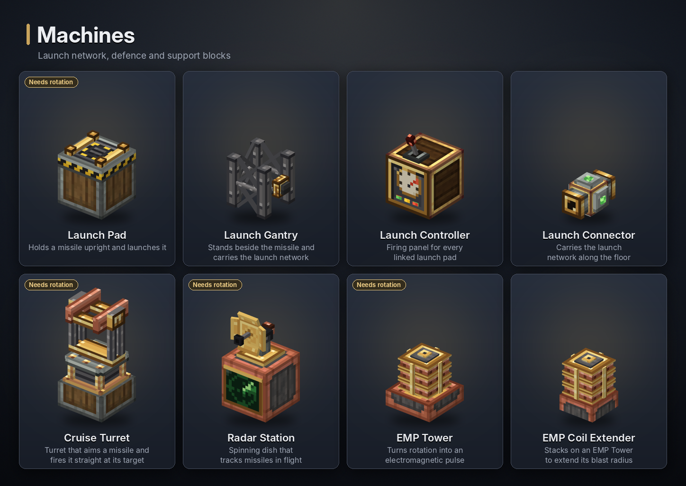
</p>

## Installation

| Needs | Version |
|---|---|
| Minecraft | 1.21.1 |
| NeoForge | 21.1.219 or newer |
| [Create](https://modrinth.com/mod/create) | 6.0.10 or newer (brings Ponder and Flywheel with it) |
| [JEI](https://modrinth.com/mod/jei) | optional, 19.x, shows every recipe |
| [Tom's Simple Storage](https://modrinth.com/mod/toms-storage) | optional, for storage automation |
| [BlueMap](https://modrinth.com/plugin/bluemap) | optional, 5.x, shows missiles on its web map |

Drop the `create-icbm` jar into your `mods` folder next to Create. The mod is needed on both the server and every
client.

## Your first launch

<p align="center">
  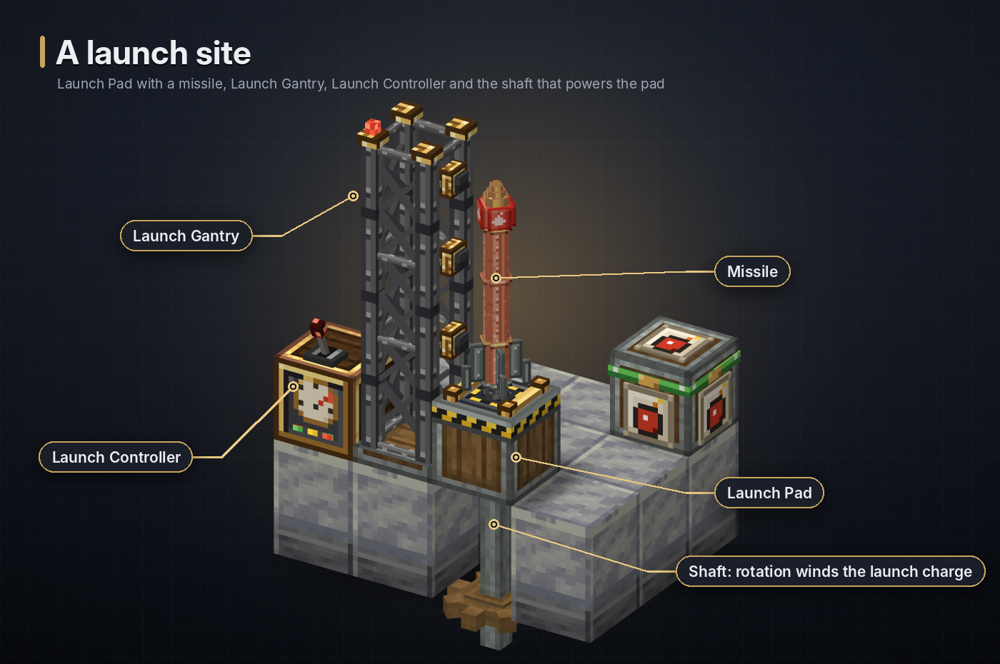
</p>

1. **Place a Launch Pad** on the ground and give it rotation through a shaft from below. The pad draws 8 SU per RPM.
   At 64 RPM it winds up a full launch charge in about 4 seconds, and it only fires when fully wound.
2. **Build the launch network.** Put a **Launch Gantry** next to the pad and a **Launch Controller** touching the
   gantry or the pad. Use **Launch Connectors** like cables to reach pads further away. Everything that touches forms
   one network, and the controller fires every pad in it.
3. **Make a missile.** Craft a Missile Casing, turn it into a Missile Module, then arm it by deploying an explosive
   crate onto it with a Deployer (or combine both at a crafting table).
4. **Load it.** Right-click the pad with the missile, or feed it in with a hopper, funnel or chute.
5. **Pick a target.** Aim a **Laser Range Finder** at a block and right-click, then right-click the controller with
   it. You can also type the coordinates into the controller.
6. **Fire!** Press *Launch* in the controller, give the controller a redstone signal, or use a **Remote Detonator** or
   **Laser Designator** tuned to the controller's radio channel.

> Feeling brave? Right-click a missile on a pad to sit on it. You go along for the ride when it launches.

## Machines

| Machine | Power | In short |
|---|---|---|
| [Launch Pad](#launch-pad) | 8 SU/RPM, shaft from behind | Holds a missile and launches it in a ballistic arc. |
| [Launch Gantry](#launch-gantry) | none | Stands next to the missile and links the launch network. |
| [Launch Connector](#launch-connector) | none | A flat cable for the launch network. |
| [Launch Controller](#launch-controller) | none | Target, radio channel and the *Launch* button for a whole network. |
| [Cruise Turret](#cruise-turret) | 6 SU/RPM, shaft below | A turret that aims a missile and fires it straight at the target. |
| [Radar Station](#radar-station) | 4 SU/RPM, shaft below, 16 RPM or more | Tracks incoming missiles up to 500 blocks away. |
| [EMP Tower](#emp-tower) | 16 SU/RPM, shaft below | Fires an electromagnetic pulse that drains machines and downs missiles. |
| [EMP Coil Extender](#emp-coil-extender) | none | Stacks on an EMP Tower for a bigger pulse. |

A machine runs while its shaft turns at or above its minimum speed and the network isn't overstressed. Engineer's
Goggles show each machine's charge and status, and every machine has a Ponder scene: hold **W** over it in your
inventory. Server owners can turn the rotation requirement off with `use_energy = false` (see
[Configuration](#configuration)).

### Launch Pad

<p align="center">
  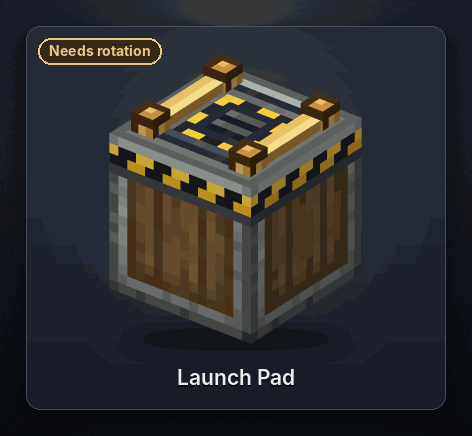
</p>

The pad launches away from the face you place it on: on the ground it fires upwards. Its shaft goes into the
opposite side, so a pad on the ground takes its shaft from below.

- **Power:** 8 SU per RPM (512 SU at 64 RPM). Turning winds up the launch charge: about 4 seconds at 64 RPM, 16
  seconds at 16 RPM and 1 second at 256 RPM. A missile only leaves on a full charge, and a launch uses all of it.
- **Loading:** right-click the pad with a missile, or let a hopper, funnel or chute feed it from any side.
  **Shift + right-click** with an empty hand takes the missile back. A pad can't be loaded while its last missile is
  still above it. Every missile works: explosive missiles, Missile Modules, Surface to Air Missiles and Delivery
  Missiles.
- **Settings** (right-click the pad):
  - **Lock Height** (default 3): how far the missile climbs straight up before it turns towards the target.
  - **Firing Delay** (in ticks, default 0): a wait before this pad fires, to stagger a salvo.
  - **Group** and **Index**: labels shown on the goggles. The controller fires every pad on its network together.
  - **Missile Rotation** (top right): **Alt + click** turns the missile clockwise, **Shift + click** the other way.
    This only changes how it looks and where you sit.
- **Firing:** the pad has no button of its own. It fires when a Launch Controller on its network fires.
- **Riding:** right-click the loaded missile to sit on it and ride it to the target.

**Flight.** The missile warms up on the pad for 2 seconds, climbs to its lock height and flies a ballistic arc at 10
blocks a second. The arc peaks as high as the target is far, up to 1,000 blocks. Targets 500 blocks or more away
make the missile climb straight up out of sight. It then crosses the map quickly, through unloaded chunks too, and
drops back in above the target. A pad reaches **10,000 blocks** in each direction and needs targets at least 10
blocks away.

**Accuracy.** A missile lands within about 2 blocks of the target, up to 12 at the full 10,000 blocks, plus 1 block
for every extra pad in the same salvo. The controller shows the expected spread.

<p align="center">
  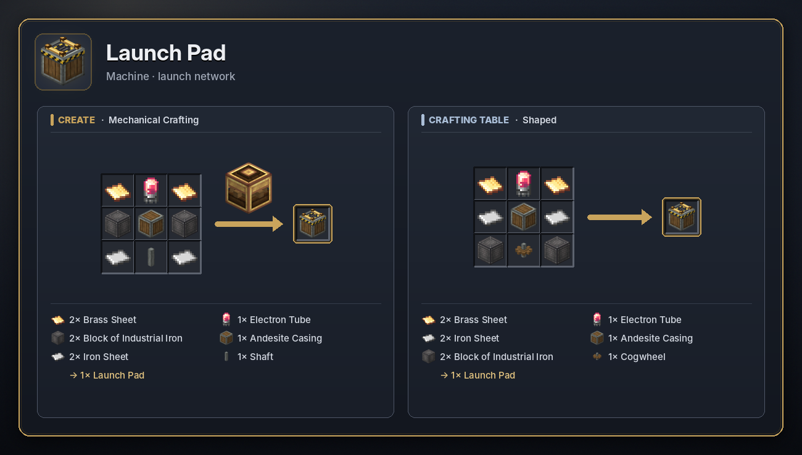
</p>

### Launch Gantry

<p align="center">
  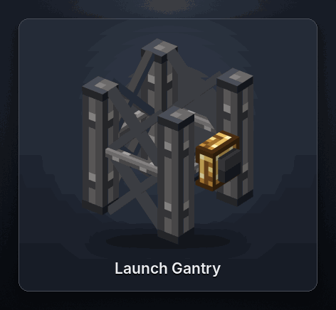
</p>

A girder that stands next to the missile on its pad. Gantries stack and link up with a controller above or below them.
They carry the launch network between pads and the controller, and pass items through: a funnel or hopper on a
gantry loads the pads behind it. A gantry isn't required for a launch, it just looks the part and links things up.

<p align="center">
  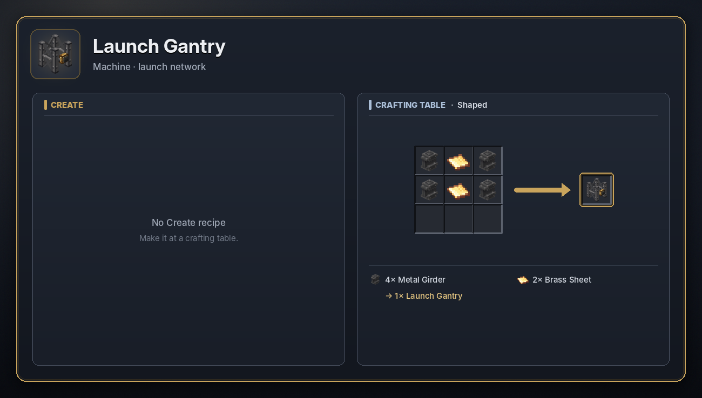
</p>

### Launch Connector

<p align="center">
  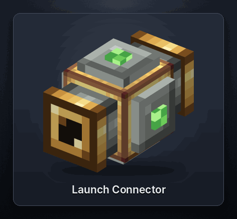
</p>

A flat cable for the launch network. Its arms reach out to pads, gantries, controllers, Cruise Turrets and any block
with an inventory, so one controller can fire pads spread across a whole silo field.

<p align="center">
  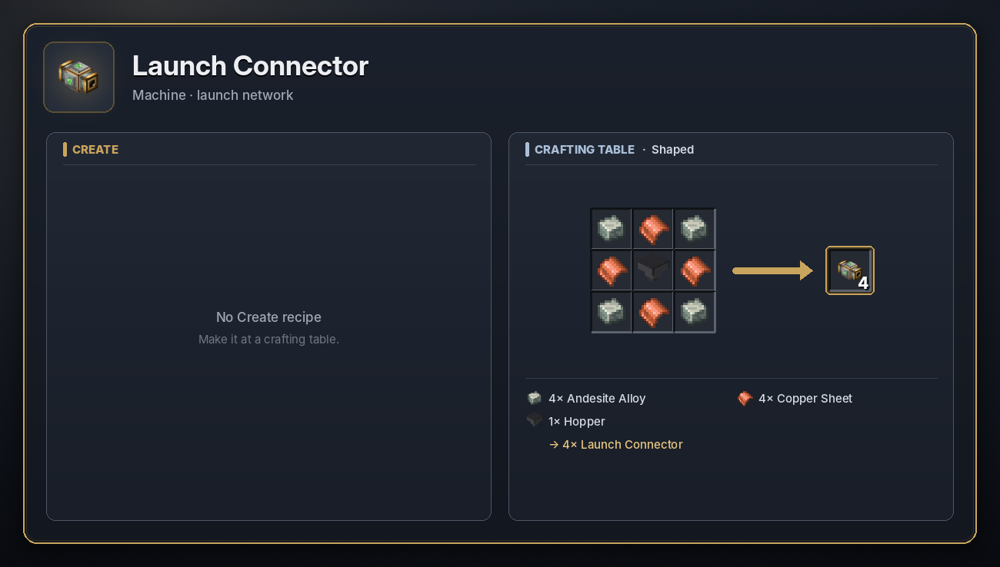
</p>

### Launch Controller

<p align="center">
  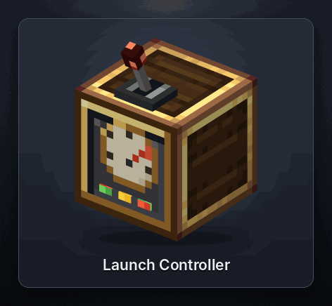
</p>

The firing panel for every launcher on its network: pads, and Cruise Turrets too. It needs no rotation.

- **Target:** type it as `x, y, z` (decimals allowed), or right-click the controller with a
  [Laser Range Finder](#laser-range-finder) holding a target.
- **Radio channel:** any letters and numbers. Tools and radars on the same channel talk to it. **Alt + click** the
  radio icon to stop it listening.
- **Launch:** fires every ready launcher on the network. Hover over the button to see which are not ready and why
  (no missile, not wound up, target too close or too far, something in the way).
- **Acc:** the expected landing spread for this salvo.
- **Redstone:** a lever, button, repeater or redstone dust pointing into the controller fires it. While the signal
  stays on it fires again as soon as a pad is ready, so use a pulse for a single salvo.
- **Radio:** a Remote Detonator on its channel fires it at the current target. A Laser Designator sets a new target
  and fires. A Radar Station on its channel retargets it onto an incoming missile and fires.
- **Loading:** missiles put into a controller (by hand, hopper or funnel) go to the empty pads in its network.

<p align="center">
  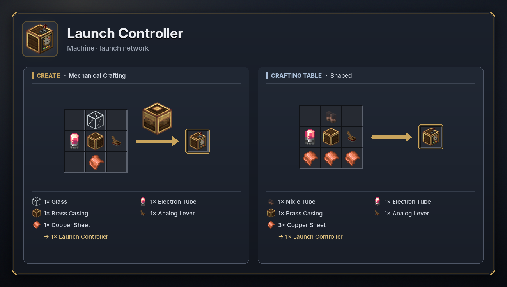
</p>

### Cruise Turret

<p align="center">
  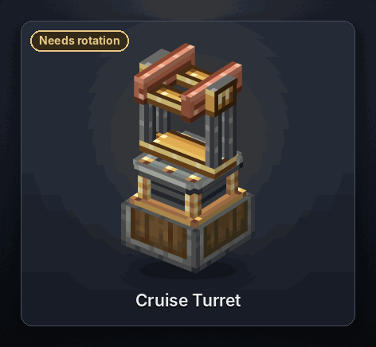
</p>

A rotating turret that swings round to face its target and fires a missile straight at it.

- **Power:** 6 SU per RPM from a shaft below. It turns at its normal speed at 32 RPM, slower below that, and up to 4
  times faster at 128 RPM. It winds up a launch charge the same way as the Launch Pad.
- **Screen** (right-click): missile slot, charge bar, target (`x, y, z`), radio channel and a *Launch* button.
- **Firing:** it fires once it is on target and fully wound. Press *Launch*, give it a redstone signal, fire it from a
  Launch Controller on the same network, or use a Remote Detonator or Laser Designator on its channel.
- **Air defence:** set it to a Radar Station's channel and load a [Surface to Air Missile](#surface-to-air-missile).
  When the radar spots an incoming missile, the turret aims at it and fires, and the SAM locks on.
- **Flight:** missiles fly in a straight line at 40 blocks a second, with fuel for about 400 blocks, then fall. The
  target has to be at least 20 blocks away, and the space just above the turret has to be clear.
- Takes any missile, by hand, hopper, funnel or chute. Right-click it with a Laser Range Finder to hand over a target.

<p align="center">
  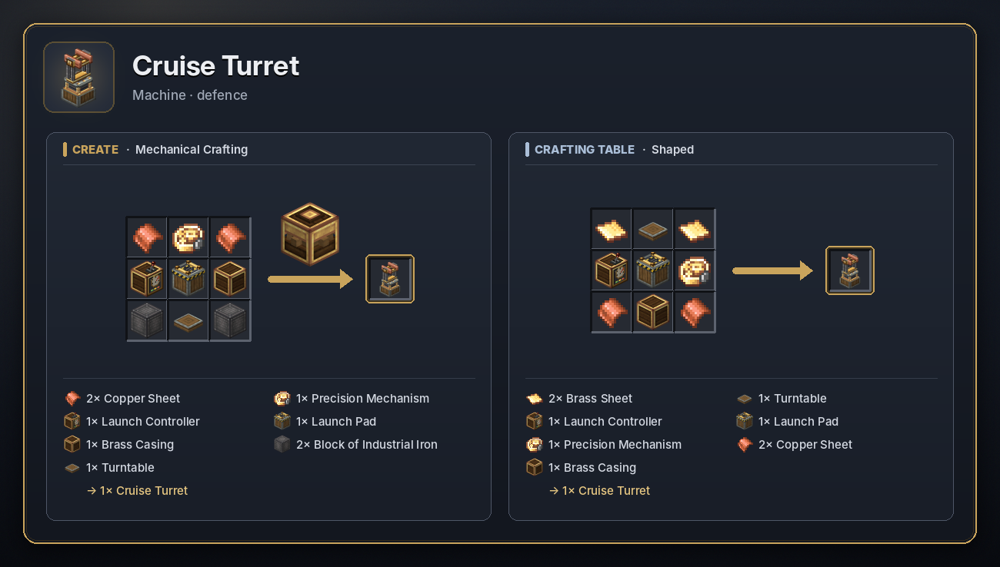
</p>

### Radar Station

<p align="center">
  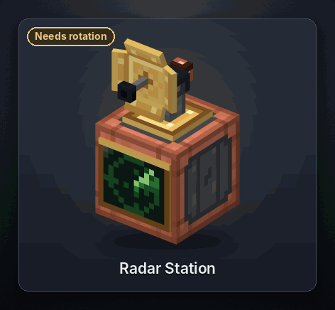
</p>

A spinning dish that watches the sky for missiles carrying a warhead. Surface to Air Missiles and Delivery Missiles
don't set it off.

- **Power:** 4 SU per RPM from a shaft below, at **16 RPM or more**.
- **Screen** (right-click): a live radar screen, the **detection range** (default 100, up to 500 blocks), the
  **trigger range** (default 50, drawn on the screen as an inner box), the radio channel and a redstone switch.
- **Incoming missiles:** a missile counts as incoming while it flies towards the radar. The radar scans four times a
  second over a square of its detection range.
- **Redstone:** while missiles are incoming it powers every side, one signal level per missile (up to 15). On by
  default. Use the switch on its screen, or right-click it with Redstone Dust, to turn it on or off.
- **Radio:** every 2 seconds while a missile is incoming, it sends the closest one on its channel. Cruise Turrets on
  that channel shoot at it, EMP Towers fire if it is inside their radius, and Launch Controllers fire at it.
- The radar can't be read by tools, so type its channel into the other machines.

<p align="center">
  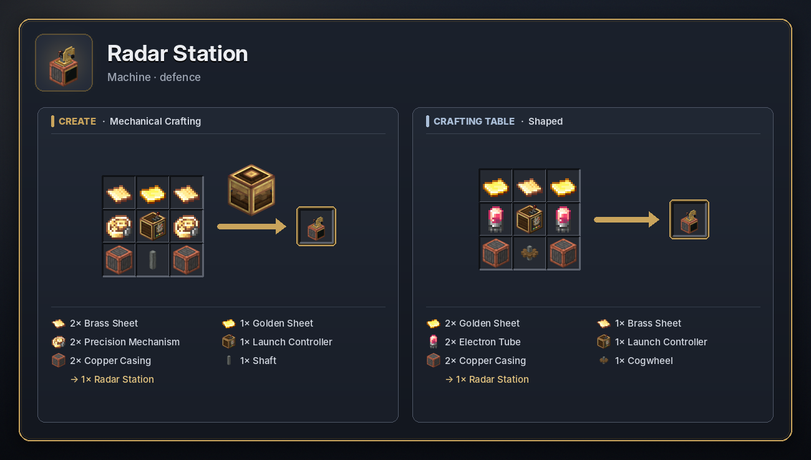
</p>

### EMP Tower

<p align="center">
  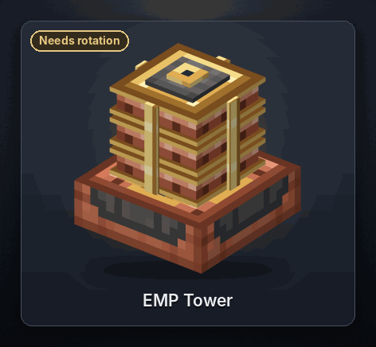
</p>

A coil that turns rotation into an electromagnetic pulse.

- **Power:** 16 SU per RPM from a shaft below. Charging takes longer the bigger the pulse: a radius of 60 charges in
  about 14 seconds at 64 RPM, the full 150 in about 88 seconds. Faster shafts charge it quicker. After firing it cools
  down for 10 seconds.
- **Screen** (right-click): the pulse **radius** (default 60, up to 150 plus 20 for each Coil Extender), the radio
  channel, a charge bar and a *Fire* button.
- **Firing:** press *Fire*, power it with redstone, use a Remote Detonator or Laser Designator on its channel, or set
  it to a Radar Station's channel to fire automatically when an incoming missile is inside its radius.
- **The pulse** reaches the radius in every direction. It drains energy from machines, items and inventories, puts out
  lit explosives, turns creepers into charged creepers and hits every missile in range: half of them are destroyed
  outright, most of the rest lose their engine and fall, and a few set off their warhead.

<p align="center">
  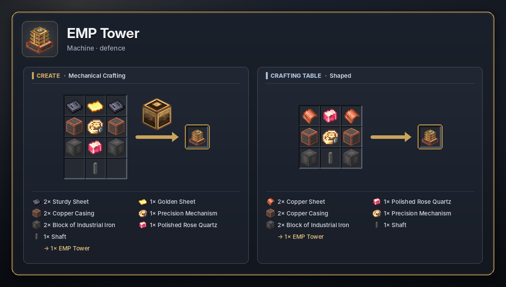
</p>

### EMP Coil Extender

<p align="center">
  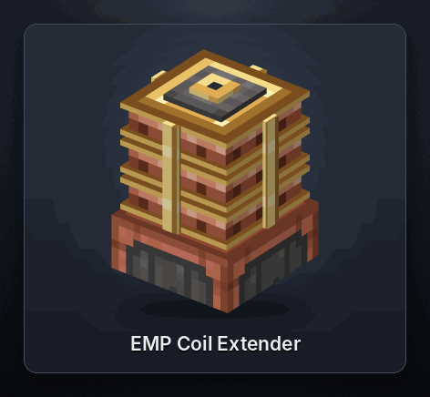
</p>

Stack Coil Extenders directly on top of an EMP Tower. Each one adds 20 blocks to the tower's maximum radius. They
need no shaft of their own, and right-clicking one opens the tower's screen.

<p align="center">
  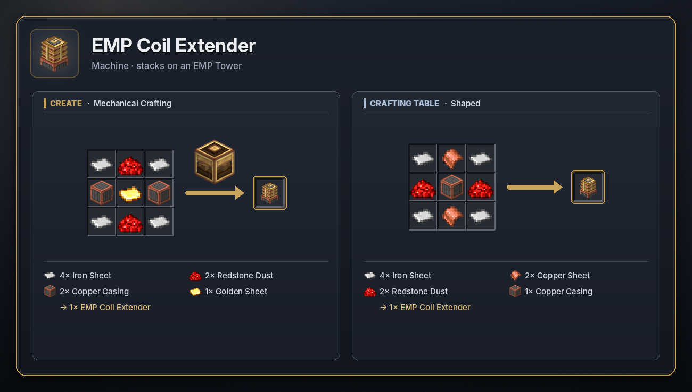
</p>

## Missiles

<p align="center">
  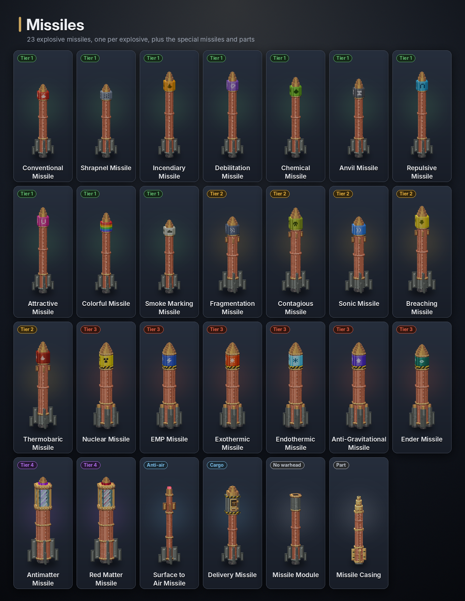
</p>

| Missile | What it is |
|---|---|
| [Missile Casing](#missile-casing) | The empty rocket body every missile starts from. |
| [Missile Module](#missile-module) | A casing with a motor. It flies, and it is what you arm. |
| [Explosive Missiles](#explosive-missiles) | A Missile Module armed with one of the 27 explosives. |
| [Surface to Air Missile](#surface-to-air-missile) | Hunts down other missiles in the air. |
| [Delivery Missile](#delivery-missile) | Carries a stack of items to a chest or a [Mail](#mail) parcel. |

### Missile Casing

<p align="center">
  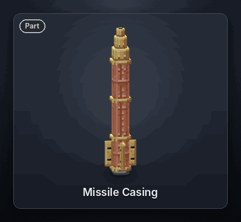
</p>

A pressed sheet-metal rocket body. It does nothing on its own: fit it with a motor to make a Missile Module, a
Surface to Air Missile or a Delivery Missile.

<p align="center">
  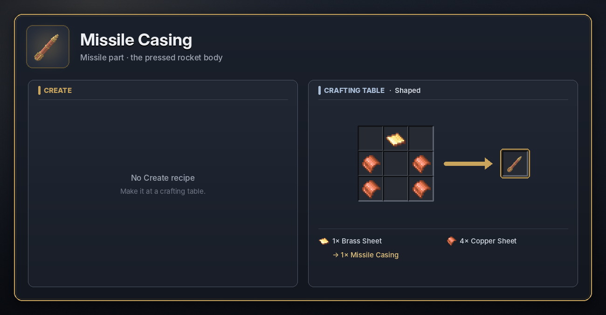
</p>

### Missile Module

<p align="center">
  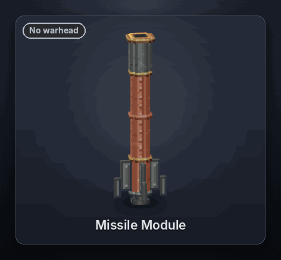
</p>

A Missile Casing fitted with an Electron Tube and a Blaze Powder motor. It launches and flies like any missile, but
carries only a tiny charge, so it is good for testing your aim. Arm it with an explosive crate to make an
[explosive missile](#explosive-missiles).

<p align="center">
  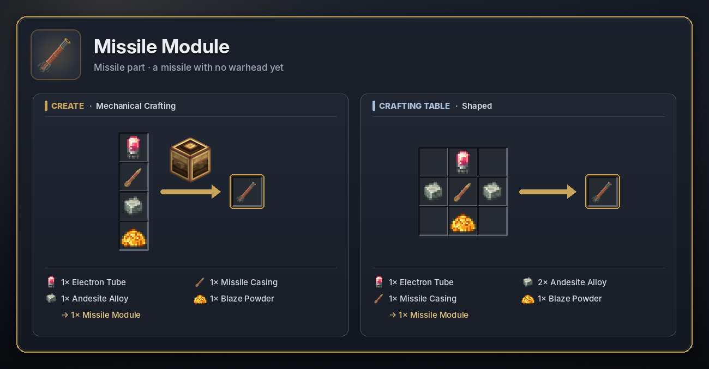
</p>

### Explosive Missiles

A Missile Module armed with an explosive crate. Put the module on a Depot or belt under a Deployer holding the crate,
or combine both at a crafting table. The warhead goes off when the missile hits the ground or comes within 2 blocks
of its target.

<p align="center">
  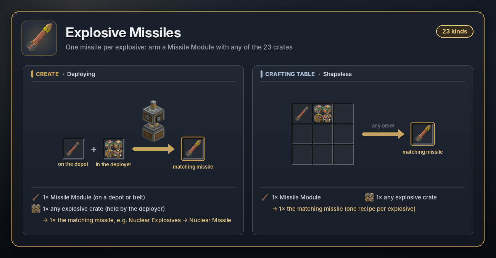
</p>

Every explosive makes its own missile. Higher tiers are tougher to shoot down:

| Tier | Health | Missiles |
|---|---|---|
| 1 | 50 | [Conventional Missile](#condensed), [Shrapnel Missile](#shrapnel), [Incendiary Missile](#incendiary), [Debilitation Missile](#debilitation), [Chemical Missile](#chemical), [Anvil Missile](#anvil), [Repulsive Missile](#repulsive), [Attractive Missile](#attractive), [Colorful Missile](#colorful), [Smoke Marking Missile](#smoke-marking), [Flashbang Missile](#flashbang), [Recon Missile](#recon) |
| 2 | 80 | [Fragmentation Missile](#fragmentation), [Contagious Missile](#contagious), [Sonic Missile](#sonic), [Breaching Missile](#breaching), [Thermobaric Missile](#thermobaric), [Phantom Enemy Missile](#phantom-enemy), [Darkness Missile](#darkness) |
| 3 | 100 | [Nuclear Missile](#nuclear), [EMP Missile](#emp), [Exothermic Missile](#exothermic), [Endothermic Missile](#endothermic), [Anti-Gravitational Missile](#anti-gravitational), [Ender Missile](#ender) |
| 4 | 200 | [Antimatter Missile](#antimatter), [Red Matter Missile](#red-matter) |

Each explosive's own section below shows its missile and recipe.

### Surface to Air Missile

<p align="center">
  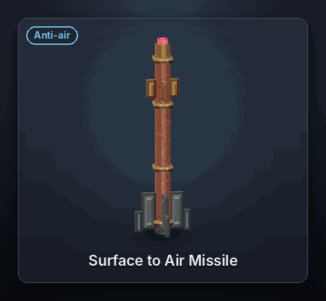
</p>

A missile that hunts other missiles. Fire it from a [Cruise Turret](#cruise-turret), a handheld
[rocket launcher](#rocket-launcher-direct) or even a Launch Pad.

- In flight it looks for missiles within 30 blocks around it, twice a second, and chases the nearest one at 80 blocks
  a second. It goes after any missile except other SAMs, friendly ones included.
- Within 4 blocks it hits for 100 damage and is spent. One SAM brings down any tier 1 to 3 missile; a tier 4 missile
  takes two.
- A missile shot down by a SAM does **not** set off its warhead.
- Fired from a turret on a radar's channel, the SAM is locked onto the radar's target from the start.
- It has 10 seconds of fuel once it locks on, and gives up after 60 seconds in the air.

<p align="center">
  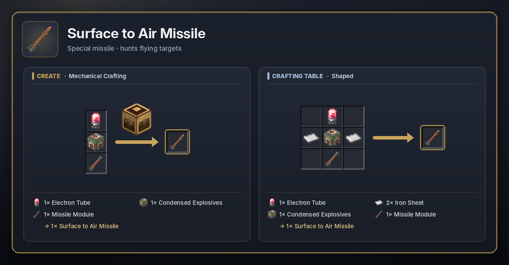
</p>

### Delivery Missile

<p align="center">
  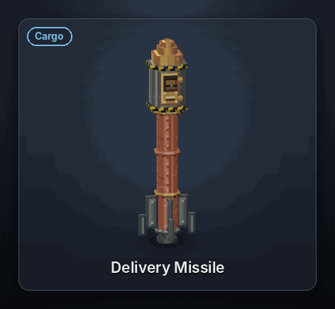
</p>

A missile that carries one stack of items instead of a warhead. It does no damage.

<p align="center">
  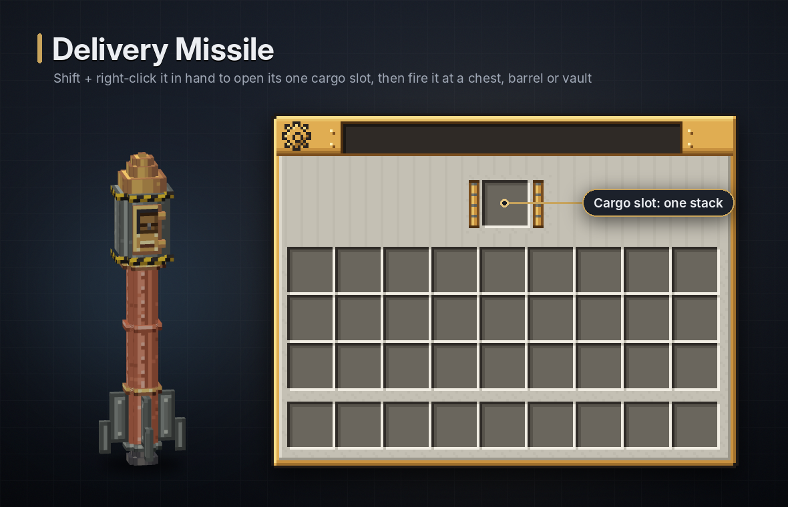
</p>

- **Loading:** **shift + right-click** it in your hand to open its cargo slot. You can also load it like a bundle:
  right-click a stack onto it in your inventory, and right-click it with an empty cursor to take the cargo out.
  Anything a chest slot can hold fits, shulker boxes included, but not another loaded Delivery Missile.
- **On impact** it puts the stack into the container it hits: a chest, barrel, Create vault or any other block with
  an inventory. Whatever doesn't fit, or everything if it hit no container, is left in a [Mail](#mail) parcel.
- If it is shot down, hit by an EMP or runs out of time, the cargo still lands in a parcel below it.
- The sender is the player who fired it: whoever pressed *Launch*, used the radio tool or held the rocket launcher.

<p align="center">
  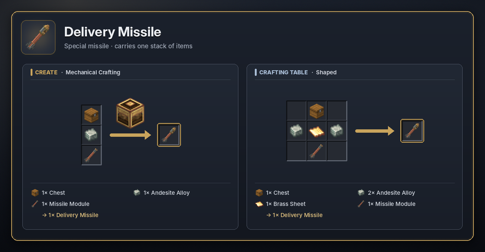
</p>

### Mail

<p align="center">
  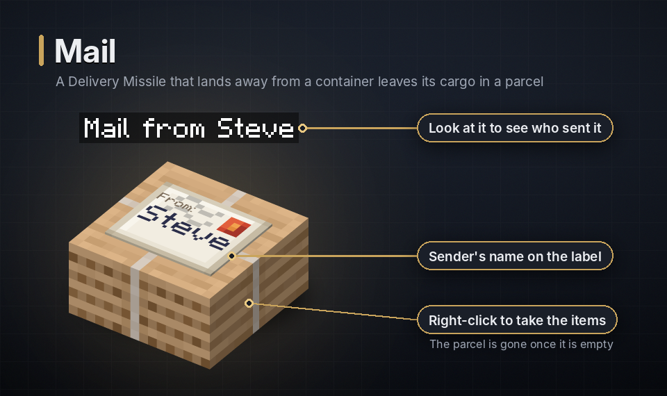
</p>

When a Delivery Missile has no container to fill, it leaves a **Mail** parcel where it lands, the size of a slab. Its
label shows the name of the player who launched the missile, and looking at it shows *Mail from &lt;name&gt;*.

- **Right-click** the parcel to take the items straight into your inventory. Once it is empty it disappears. If your
  inventory is full, whatever didn't fit stays inside for later.
- It can't be crafted, broken, pushed by pistons or taken from the Creative inventory, and explosions can't break it,
  so a delivery is never scattered on the ground. Hoppers can't empty it either.
- A parcel nobody has opened for 3 minutes starts to **ding** every 15 to 25 seconds, so it's easy to find, until
  someone opens it.
- With [BlueMap](#bluemap) installed, every unopened parcel shows on the web map until it is opened.

### Flight and interception

- **Health:** tier 1 missiles have 50 health, tier 2 80, tier 3 100 and tier 4 200. Surface to Air and Delivery
  Missiles have 80.
- **Shooting them down:** missiles can be hit with weapons, arrows and other projectiles, SAMs and EMP pulses. A
  missile destroyed by an explosion or fire sets off its warhead where it is; anything else just destroys it.
- **EMP:** a pulse destroys half the missiles it reaches, stops the engine of most of the others so they fall, and
  sets off the warhead of a few.
- **Hitting things:** a missile that flies into a mob or player hurts it, more the faster it flies.
- Missiles stay in the air for up to 2 hours before they give up. Right-click one in flight to climb aboard.

## Explosives

<p align="center">
  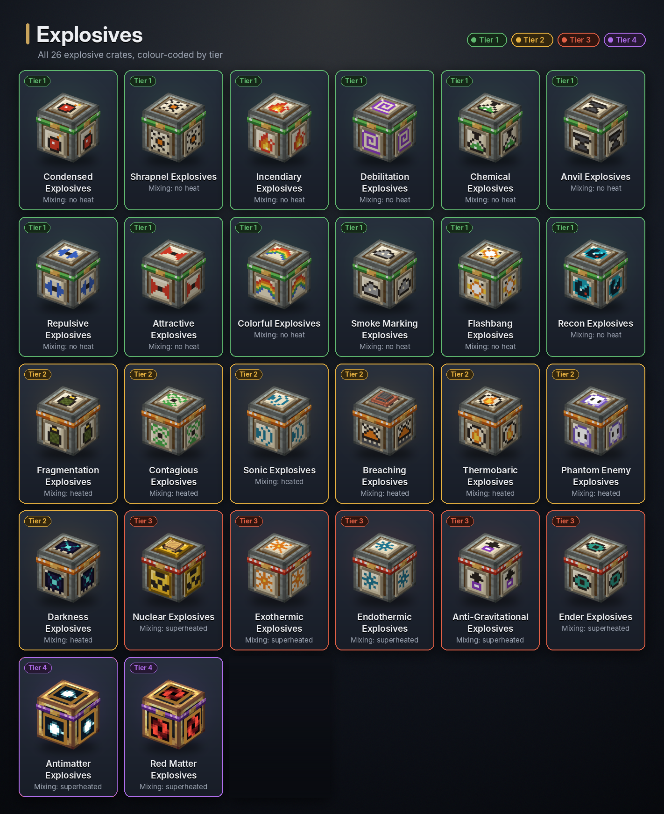
</p>

Every explosive comes three ways: as a **crate** you place and light, as a **missile** warhead and as a **bomb cart**. Each one below shows all three, what it does, and its recipes.

**Setting off a crate:**

- a redstone signal, or placing it on a powered spot;
- right-click with Flint and Steel or a Fire Charge, or hit it with a burning arrow;
- another explosion or a Sonic shockwave reaching it;
- a [Remote Detonator](#remote-detonator) it is wired to (right-click the crate with the detonator to wire it);
- placing it next to fire or lava.

Once lit, the crate becomes a lit block that falls and can be pushed, and goes off when its fuse runs out: 5 seconds for most explosives. An EMP puts a lit crate out. Mining a crate is safe and gives it back.

Tier 1 explosives mix in a plain Basin, tier 2 over a heated Blaze Burner, tiers 3 and 4 over a superheated one. Each explosive is made from a lower one, so you work your way up from Condensed Explosives (see [Crafting recipes](#crafting-recipes)).

| Explosive | Tier | Reach |
|---|---|---|
| [Condensed](#condensed) | 1 | Blast radius 6 blocks |
| [Shrapnel](#shrapnel) | 1 | 900 shards |
| [Incendiary](#incendiary) | 1 | Fire within 14 blocks |
| [Debilitation](#debilitation) | 1 | Gas cloud 20 blocks, 30 s |
| [Chemical](#chemical) | 1 | Gas cloud 20 blocks, 30 s |
| [Anvil](#anvil) | 1 | 625 anvil chunks |
| [Repulsive](#repulsive) | 1 | Push within 12 blocks |
| [Attractive](#attractive) | 1 | Pull within 12 blocks |
| [Colorful](#colorful) | 1 | Rainbow cloud 10 blocks, 30 s |
| [Smoke Marking](#smoke-marking) | 1 | Smoke for 5 s |
| [Flashbang](#flashbang) | 1 | Flash within 16 blocks |
| [Recon](#recon) | 1 | Glow within 32 blocks, 3 min |
| [Fragmentation](#fragmentation) | 2 | 225 explosive fragments |
| [Contagious](#contagious) | 2 | Viral cloud 20 blocks, 30 s |
| [Sonic](#sonic) | 2 | Shockwave about 15 blocks |
| [Breaching](#breaching) | 2 | 3 x 3 tunnel, 7 blocks deep |
| [Thermobaric](#thermobaric) | 2 | Terrain up to 30 blocks, lethal within 50 |
| [Phantom Enemy](#phantom-enemy) | 2 | 4 phantoms per player within 24 blocks |
| [Darkness](#darkness) | 2 | Darkness within 24 blocks, 3 min |
| [Nuclear](#nuclear) | 3 | Terrain up to 35 blocks, lethal within 50, fallout to 80 |
| [EMP](#emp) | 3 | Pulse 50 blocks in every direction |
| [Exothermic](#exothermic) | 3 | Nether land within 30 blocks |
| [Endothermic](#endothermic) | 3 | Frozen land within 30 blocks |
| [Anti-Gravitational](#anti-gravitational) | 3 | Lifts everything within 30 blocks for 2 min |
| [Ender](#ender) | 3 | Vortex 20 blocks, 8 s |
| [Antimatter](#antimatter) | 4 | Erases 55 blocks, lethal within 110 |
| [Red Matter](#red-matter) | 4 | Black hole, grows up to size 70 |

### Tier 1

Mixed in a plain Basin. Missile health 50.

#### Condensed

<p align="center">
  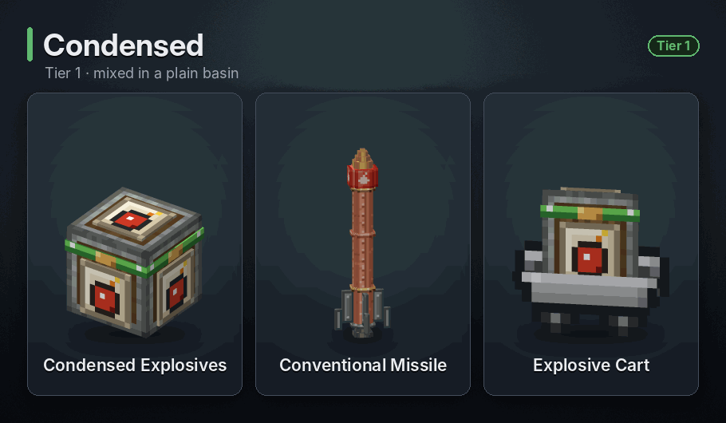
</p>

*Blast radius 6 blocks · Crate fuse: instant · Cart fuse: 5 s*

A stronger TNT. It breaks blocks out to 6 blocks, where TNT reaches 4, and hurts anything in that range. About one broken block in six drops as an item. The crate goes off the instant it is lit, and it is the base of every other explosive.

<details>
<summary><b>Recipes</b>: Condensed Explosives, Conventional Missile, Explosive Cart</summary>

<p align="center">
  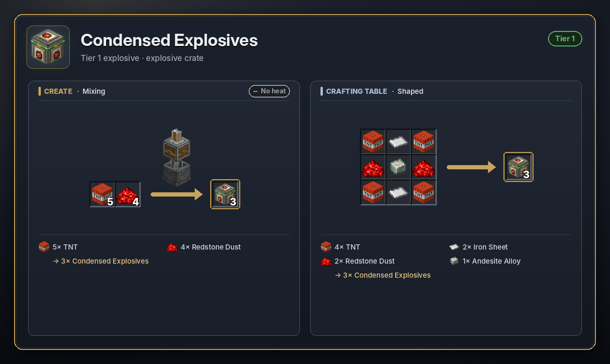<br>
  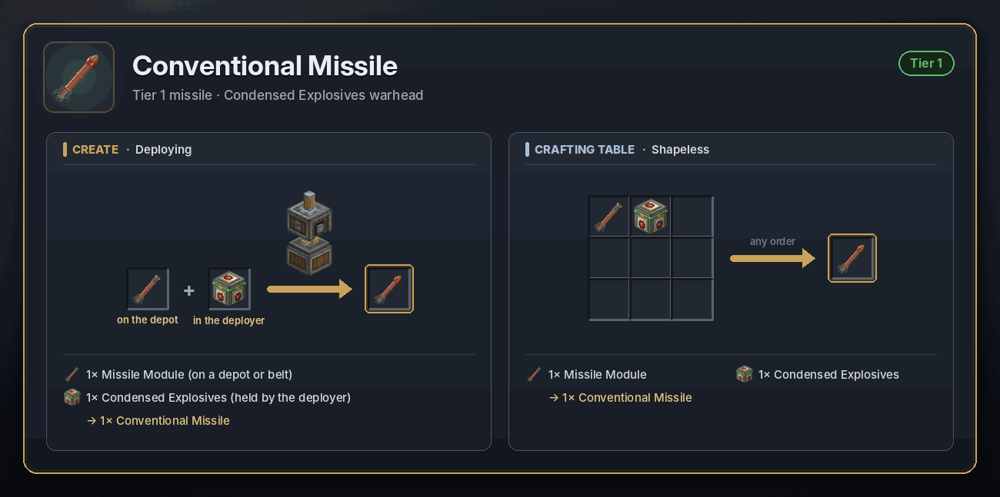<br>
  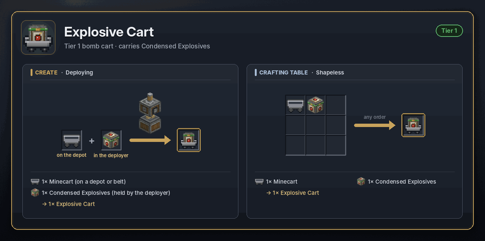
</p>
</details>

#### Shrapnel

<p align="center">
  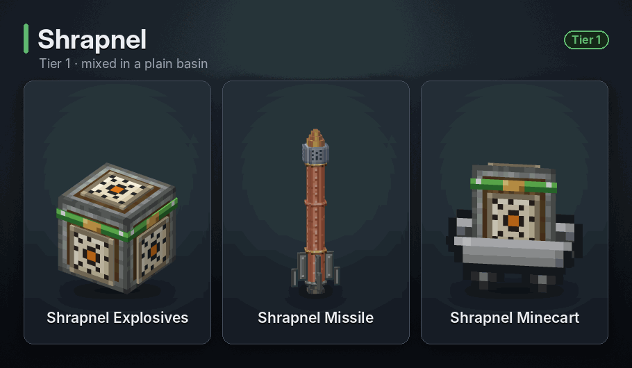
</p>

*900 shards · Crate fuse: 5 s · Cart fuse: 5 s*

Sprays 900 burning metal shards in every direction. Each one hits for about 6 to 14 damage and sets its target on fire for 5 seconds. The blast itself breaks nothing, but shards smash glass, leaves, snow and glowstone in their way. Water slows them down and puts their flames out.

<details>
<summary><b>Recipes</b>: Shrapnel Explosives, Shrapnel Missile, Shrapnel Minecart</summary>

<p align="center">
  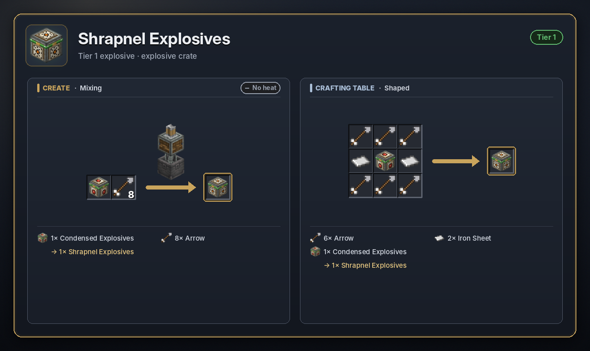<br>
  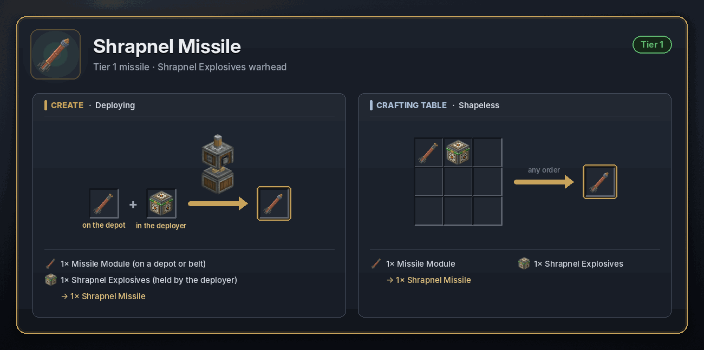<br>
  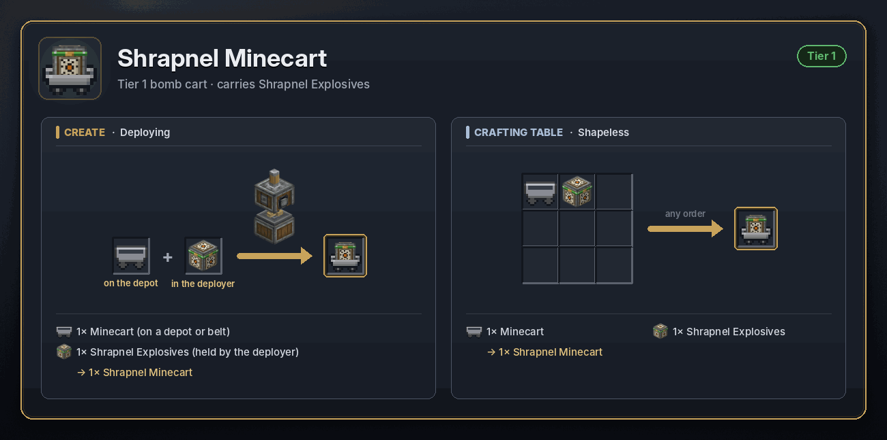
</p>
</details>

#### Incendiary

<p align="center">
  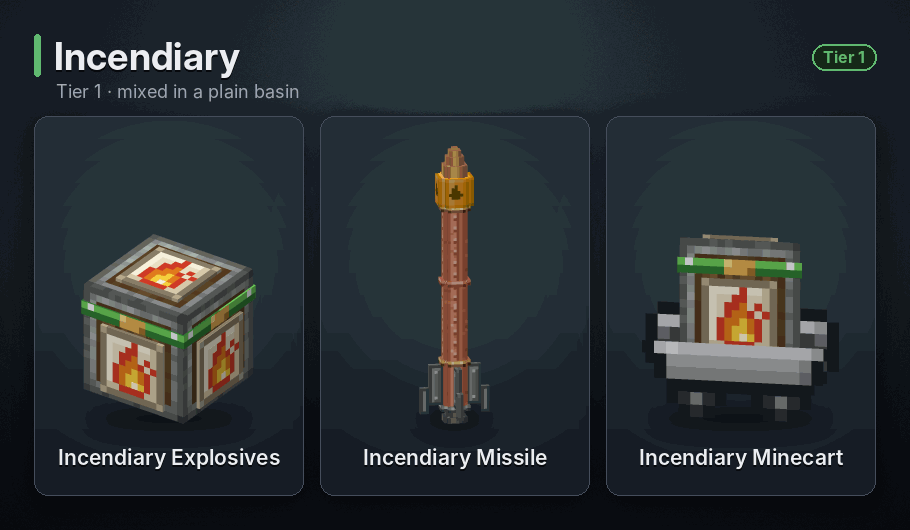
</p>

*Fire within 14 blocks · Crate fuse: 5 s · Cart fuse: 5 s*

Scatters fire over everything within 14 blocks, thinner towards the edge, and melts away ice. It breaks no blocks itself; the fire does the rest.

<details>
<summary><b>Recipes</b>: Incendiary Explosives, Incendiary Missile, Incendiary Minecart</summary>

<p align="center">
  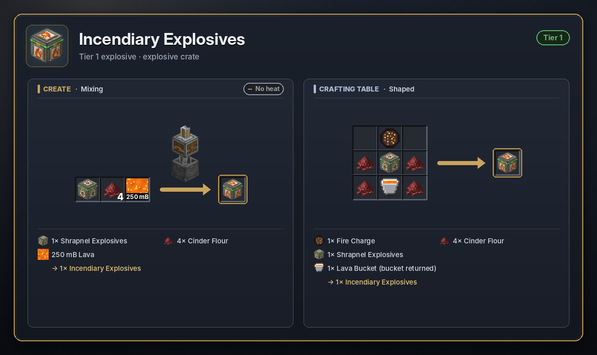<br>
  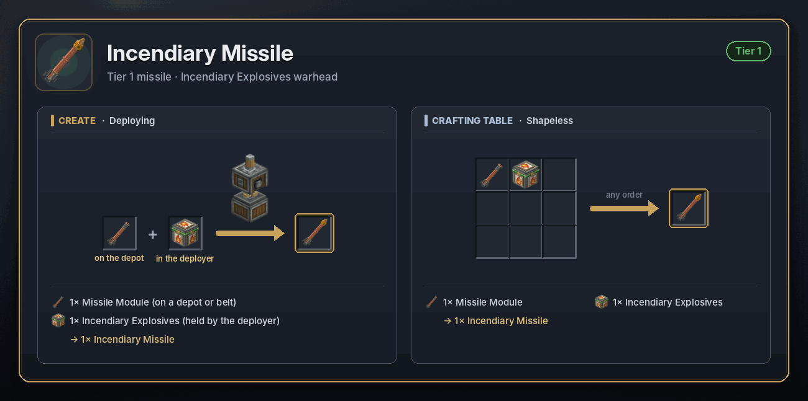<br>
  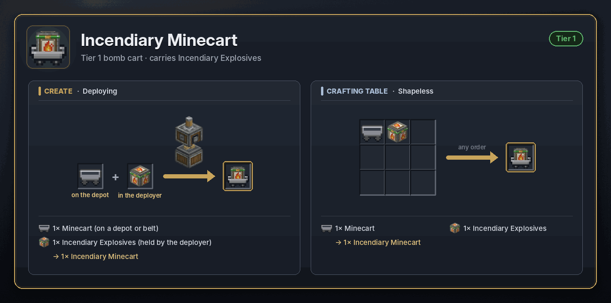
</p>
</details>

#### Debilitation

<p align="center">
  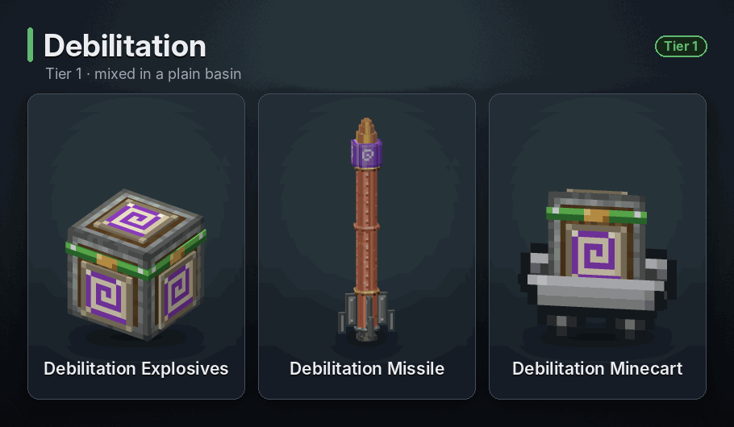
</p>

*Gas cloud 20 blocks, 30 s · Crate fuse: 5 s · Cart fuse: 5 s*

Releases a white gas cloud that spreads out to 20 blocks and lingers for 30 seconds. Anyone inside is poisoned, slowed down hard and gets Mining Fatigue. Solid walls keep the gas out. Breaks nothing.

<details>
<summary><b>Recipes</b>: Debilitation Explosives, Debilitation Missile, Debilitation Minecart</summary>

<p align="center">
  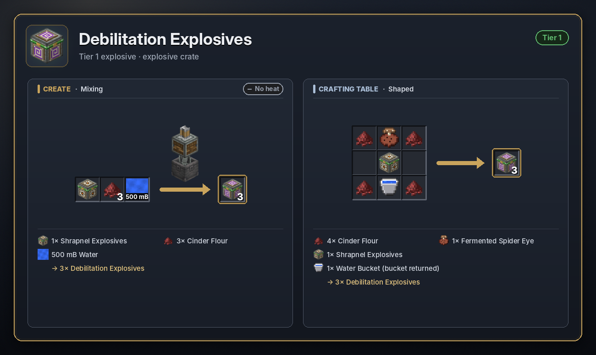<br>
  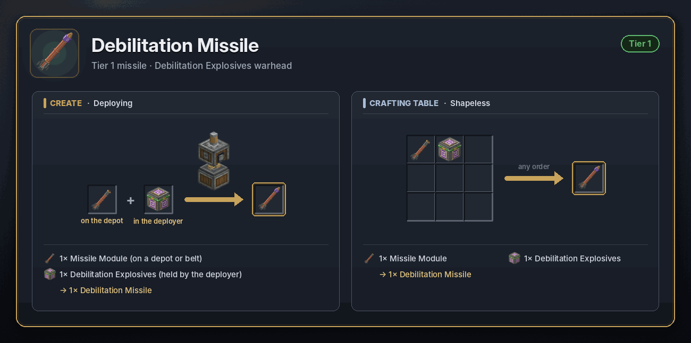<br>
  
</p>
</details>

#### Chemical

<p align="center">
  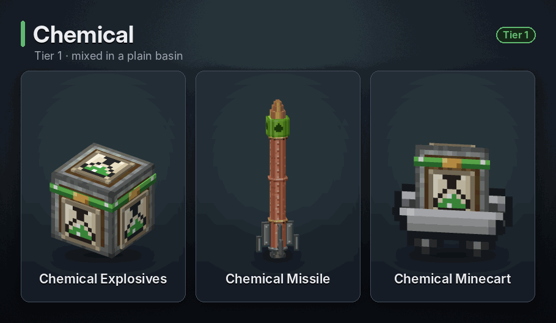
</p>

*Gas cloud 20 blocks, 30 s · Crate fuse: 5 s · Cart fuse: 5 s*

A yellow toxic cloud that spreads out to 20 blocks and lingers for 30 seconds. It brings Poison, Nausea, Hunger, Weakness and Mining Fatigue, and after about 5 seconds inside it starts dealing chemical damage that grows the longer you stay. Milk doesn't cure this poison, an [Antidote](#antidote) does. Solid walls keep the gas out.

<details>
<summary><b>Recipes</b>: Chemical Explosives, Chemical Missile, Chemical Minecart</summary>

<p align="center">
  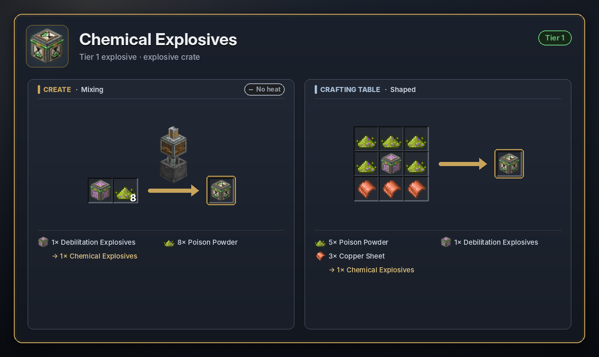<br>
  <br>
  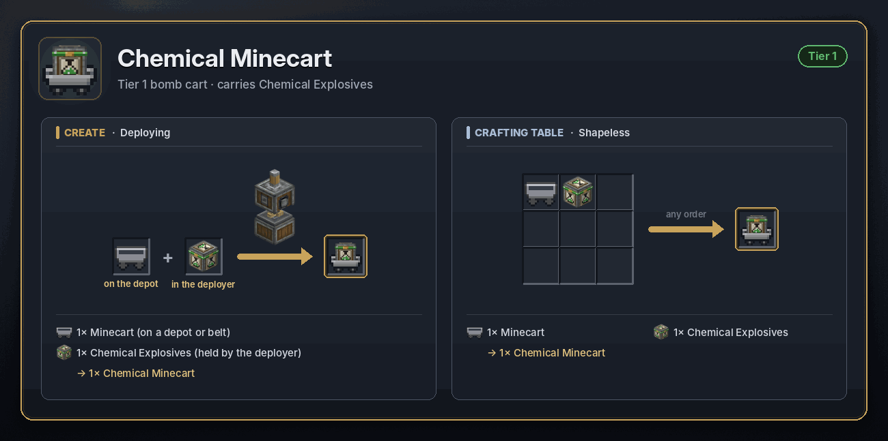
</p>
</details>

#### Anvil

<p align="center">
  
</p>

*625 anvil chunks · Crate fuse: 5 s · Cart fuse: 5 s*

Hurls 625 heavy anvil chunks that hit for about 15 to 36 damage each, with a clang. Like shrapnel, the chunks break glass, leaves and snow but leave other blocks alone.

<details>
<summary><b>Recipes</b>: Anvil Explosives, Anvil Missile, Anvil Minecart</summary>

<p align="center">
  <br>
  <br>
  
</p>
</details>

#### Repulsive

<p align="center">
  
</p>

*Push within 12 blocks · Crate fuse: 6 s · Cart fuse: 6 s*

A small blast that breaks blocks within 3 blocks and throws every mob, player and item within 12 blocks away from it, hardest up close. Players are thrown half as far. It deals no damage itself, but the landing might.

<details>
<summary><b>Recipes</b>: Repulsive Explosives, Repulsive Missile, Repulsive Minecart</summary>

<p align="center">
  <br>
  <br>
  
</p>
</details>

#### Attractive

<p align="center">
  
</p>

*Pull within 12 blocks · Crate fuse: 6 s · Cart fuse: 6 s*

A small blast that breaks blocks within 3 blocks and pulls every mob, player and item within 12 blocks towards it, the furthest ones hardest. Players are pulled half as far. It deals no damage itself.

<details>
<summary><b>Recipes</b>: Attractive Explosives, Attractive Missile, Attractive Minecart</summary>

<p align="center">
  <br>
  <br>
  
</p>
</details>

#### Colorful

<p align="center">
  
</p>

*Rainbow cloud 10 blocks, 30 s · Crate fuse: 5 s · Cart fuse: 5 s*

A harmless rainbow cloud that spreads out to 10 blocks and swirls for 30 seconds. Nothing is broken and nobody is hurt. Good for celebrations.

<details>
<summary><b>Recipes</b>: Colorful Explosives, Colorful Missile, Colorful Minecart</summary>

<p align="center">
  <br>
  <br>
  
</p>
</details>

#### Smoke Marking

<p align="center">
  
</p>

*Smoke for 5 s · Crate fuse: 5 s · Cart fuse: 5 s*

A column of smoke for 5 seconds, handy for marking a target or testing your aim before you send something heavier. Harmless.

<details>
<summary><b>Recipes</b>: Smoke Marking Explosives, Smoke Marking Missile, Smoke Marking Minecart</summary>

<p align="center">
  <br>
  <br>
  
</p>
</details>

#### Flashbang

<p align="center">
  
</p>

*Flash within 16 blocks · Crate fuse: 5 s · Cart fuse: 5 s*

Every player within 16 blocks sees a white flash fill the screen for a second before it fades, whichever way they are looking. Mobs aren't affected, nothing breaks and nobody is hurt.

<details>
<summary><b>Recipes</b>: Flashbang Explosives, Flashbang Missile, Flashbang Minecart</summary>

<p align="center">
  <br>
  <br>
  
</p>
</details>

#### Recon

<p align="center">
  
</p>

*Glow within 32 blocks, 3 min · Crate fuse: 5 s · Cart fuse: 5 s*

Sends out a radar pulse that makes every mob and player within 32 blocks glow through walls for 3 minutes. The player who launched or lit it, their team mates and their pets are left out. A crate set off by redstone with nobody to credit marks everyone. Breaks nothing.

<details>
<summary><b>Recipes</b>: Recon Explosives, Recon Missile, Recon Minecart</summary>

<p align="center">
  <br>
  <br>
  
</p>
</details>

### Tier 2

Mixed in a Basin over a heated Blaze Burner. Missile health 80.

#### Fragmentation

<p align="center">
  
</p>

*225 explosive fragments · Crate fuse: 5 s · Cart fuse: 5 s*

Throws 225 fragments that each blow up when they hit the ground or a mob, with a blast a little under half the power of TNT. Together they crater a wide area and hurt anything caught in it.

<details>
<summary><b>Recipes</b>: Fragmentation Explosives, Fragmentation Missile, Fragmentation Minecart</summary>

<p align="center">
  <br>
  <br>
  
</p>
</details>

#### Contagious

<p align="center">
  
</p>

*Viral cloud 20 blocks, 30 s · Crate fuse: 5 s · Cart fuse: 5 s*

A green viral cloud that spreads out to 20 blocks and lingers for 30 seconds. It brings strong Poison, Blindness, Hunger, Weakness and Mining Fatigue, and after about 2.5 seconds inside it deals damage that grows over time. Pigs turn into zombified piglins and villagers into zombie villagers. Only an [Antidote](#antidote) cures it.

<details>
<summary><b>Recipes</b>: Contagious Explosives, Contagious Missile, Contagious Minecart</summary>

<p align="center">
  <br>
  <br>
  
</p>
</details>

#### Sonic

<p align="center">
  
</p>

*Shockwave about 15 blocks · Crate fuse: 5 s · Cart fuse: 5 s*

A shockwave that rolls outward for about a second, tearing up blocks up to about 13 blocks away across open ground (only a block or two into solid stone) and flinging mobs and players into the air. Torn-up blocks are destroyed and some fly off as debris. Other explosive crates it reaches are set off. It deals no direct damage.

<details>
<summary><b>Recipes</b>: Sonic Explosives, Sonic Missile, Sonic Minecart</summary>

<p align="center">
  <br>
  <br>
  
</p>
</details>

#### Breaching

<p align="center">
  
</p>

*3 x 3 tunnel, 7 blocks deep · Crate fuse: instant · Cart fuse: instant*

Punches a 3 by 3 tunnel 7 blocks deep, even through obsidian. Only unbreakable blocks such as bedrock stop it. A crate fires the moment it is lit, straight into the block it was placed against, so place it on the wall you want to breach. As a missile or bomb cart it digs straight down. It also hurts anything within 3 blocks.

<details>
<summary><b>Recipes</b>: Breaching Explosives, Breaching Missile, Breaching Minecart</summary>

<p align="center">
  <br>
  <br>
  
</p>
</details>

#### Thermobaric

<p align="center">
  
</p>

*Terrain up to 30 blocks, lethal within 50 · Crate fuse: 5 s · Cart fuse: 5 s*

A huge pressure blast. It levels terrain up to 30 blocks away in the open (much less into solid rock), leaves no drops, sets off other crates it reaches, and kills anything exposed within 50 blocks. Only solid cover saves you.

<details>
<summary><b>Recipes</b>: Thermobaric Explosives, Thermobaric Missile, Thermobaric Minecart</summary>

<p align="center">
  <br>
  <br>
  
</p>
</details>

#### Phantom Enemy

<p align="center">
  
</p>

*4 phantoms per player within 24 blocks · Crate fuse: 5 s · Cart fuse: 5 s*

Conjures 4 fake mobs (zombies, husks, spiders and creepers) around every player within 24 blocks. They appear 6 to 12 blocks away, mostly behind you, close in and swing, but never deal damage, and the creepers never explode. Hit one and it vanishes in a puff of smoke; the rest fade after 60 seconds, or when their victim dies or gets away.

<details>
<summary><b>Recipes</b>: Phantom Enemy Explosives, Phantom Enemy Missile, Phantom Enemy Minecart</summary>

<p align="center">
  <br>
  <br>
  
</p>
</details>

#### Darkness

<p align="center">
  
</p>

*Darkness within 24 blocks, 3 min · Crate fuse: 5 s · Cart fuse: 5 s*

Gives every player and mob within 24 blocks the Darkness effect for 3 minutes, whoever set it off included. Breaks nothing.

<details>
<summary><b>Recipes</b>: Darkness Explosives, Darkness Missile, Darkness Minecart</summary>

<p align="center">
  <br>
  <br>
  
</p>
</details>

### Tier 3

Mixed in a Basin over a superheated Blaze Burner. Missile health 100.

#### Nuclear

<p align="center">
  
</p>

*Terrain up to 35 blocks, lethal within 50, fallout to 80 · Crate fuse: 5 s · Cart fuse: 5 s*

The biggest blast short of antimatter. It levels terrain up to about 35 blocks away, leaves no drops and kills anything exposed within 50 blocks. Then fallout spreads up to 80 blocks, through walls: patches of stone and dirt turn into [Radioactive Stone and Dirt](#radioactive-dirt-and-stone), and leaves and plants wither away. Pigs and villagers it reaches turn into zombified piglins and zombie villagers.

<details>
<summary><b>Recipes</b>: Nuclear Explosives, Nuclear Missile, Nuclear Minecart</summary>

<p align="center">
  <br>
  <br>
  
</p>
</details>

#### EMP

<p align="center">
  
</p>

*Pulse 50 blocks in every direction · Crate fuse: 5 s · Cart fuse: 5 s*

An electromagnetic pulse that reaches 50 blocks in every direction. It drains stored energy from machines, items and inventories, puts out lit explosive crates, charges creepers and knocks missiles out of the sky, like the [EMP Tower](#emp-tower). It breaks nothing and hurts nobody.

<details>
<summary><b>Recipes</b>: EMP Explosives, EMP Missile, EMP Minecart</summary>

<p align="center">
  <br>
  <br>
  
</p>
</details>

#### Exothermic

<p align="center">
  
</p>

*Nether land within 30 blocks · Crate fuse: 5 s · Cart fuse: 5 s*

Opens with a TNT-sized blast and a beam of light that lifts the blocks nearby into the air. 5 seconds later the land within 30 blocks turns into the Nether: rock into netherrack, magma and lava, sand and gravel into soul sand, dirt into netherrack, water and ice boiled away, and fire everywhere. The sky turns to midnight.

<details>
<summary><b>Recipes</b>: Exothermic Explosives, Exothermic Missile, Exothermic Minecart</summary>

<p align="center">
  <br>
  <br>
  
</p>
</details>

#### Endothermic

<p align="center">
  
</p>

*Frozen land within 30 blocks · Crate fuse: 5 s · Cart fuse: 5 s*

Opens with a TNT-sized blast and a beam of light, then freezes the land within 30 blocks: water turns to ice, lava to obsidian, fire goes out, netherrack turns back into dirt and snow settles on top. Mobs caught in it (not players) are poisoned and slowed down for 2 minutes. The sky turns to morning.

<details>
<summary><b>Recipes</b>: Endothermic Explosives, Endothermic Missile, Endothermic Minecart</summary>

<p align="center">
  <br>
  <br>
  
</p>
</details>

#### Anti-Gravitational

<p align="center">
  
</p>

*Lifts everything within 30 blocks for 2 min · Crate fuse: 5 s · Cart fuse: 5 s*

For 2 minutes it lifts the blocks within 30 blocks into the sky one by one, from the top down, and pushes every mob and player inside upwards. When it ends, gravity comes back and everything comes crashing down.

<details>
<summary><b>Recipes</b>: Anti-Gravitational Explosives, Anti-Gravitational Missile, Anti-Gravitational Minecart</summary>

<p align="center">
  <br>
  <br>
  
</p>
</details>

#### Ender

<p align="center">
  
</p>

*Vortex 20 blocks, 8 s · Crate fuse: 5 s · Cart fuse: 5 s*

Opens an ender vortex for 8 seconds that drags everything within 20 blocks towards its centre. Whatever reaches the middle is teleported to one random spot up to 150 blocks away. Eight Endermen turn up as it closes.

<details>
<summary><b>Recipes</b>: Ender Explosives, Ender Missile, Ender Minecart</summary>

<p align="center">
  <br>
  <br>
  
</p>
</details>

### Tier 4

Mixed in a Basin over a superheated Blaze Burner. Missile health 200.

#### Antimatter

<p align="center">
  
</p>

*Erases 55 blocks, lethal within 110 · Crate fuse: 15 s · Cart fuse: 15 s*

Erases everything within 55 blocks, bedrock included, with no drops, and kills everything within 110 blocks. Other crates inside are wiped out rather than set off. It has a 15 second fuse, so run. If red matter is anywhere nearby, the antimatter is spent wiping it out instead and nothing else is harmed.

<details>
<summary><b>Recipes</b>: Antimatter Explosives, Antimatter Missile, Antimatter Minecart</summary>

<p align="center">
  <br>
  <br>
  
</p>
</details>

#### Red Matter

<p align="center">
  
</p>

*Black hole, grows up to size 70 · Crate fuse: 5 s · Cart fuse: 5 s*

Spawns a black hole that eats every block around it, water and lava included, and grows each time it clears its surroundings, up to 70 times its starting size. It drags in mobs, players and items, and anything that reaches its core is destroyed. Missiles and lit explosives that fall in go off. With nothing left to eat it slowly shrinks and dies. An Antimatter blast nearby kills it at once.

<details>
<summary><b>Recipes</b>: Red Matter Explosives, Red Matter Missile, Red Matter Minecart</summary>

<p align="center">
  <br>
  <br>
  
</p>
</details>

## Bomb carts

<p align="center">
  
</p>

A minecart with an explosive crate in it, one for every explosive. Put it on rails by hand or with a dispenser, and
run it over a powered **activator rail** to light the fuse. The fuse is 5 seconds for most carts (see each
[explosive](#explosives)).

A cart goes off at once if it is broken while moving, set on fire, hit by a burning arrow, caught in another
explosion, slammed into a wall at speed or dropped 3 or more blocks. Broken while standing still, it drops as an item.
Bomb carts stack to 3.

Make one by deploying an explosive crate onto a Minecart, or combine both at a crafting table. A plain TNT block still
makes the vanilla TNT Minecart.

<p align="center">
  
</p>

## Tools

<p align="center">
  
</p>

| Tool | In short |
|---|---|
| [Laser Range Finder](#laser-range-finder) | Reads the coordinates of a block and hands them to a launcher. |
| [Remote Detonator](#remote-detonator) | Fires launchers, EMP Towers and wired explosive crates on its radio channel, at any distance. |
| [Laser Designator](#laser-designator) | Marks a block and calls a strike on it. |
| [Rocket Launcher: Direct](#rocket-launcher-direct) | Fires a missile in a straight line from your shoulder. |
| [Rocket Launcher: Ballistic](#rocket-launcher-ballistic) | Lobs a missile in a high arc onto where you aim. |

**Radio channels.** Launch Controllers, Cruise Turrets and EMP Towers each have a radio channel. Right-click one of them
with a Remote Detonator or Laser Designator to tune the tool to the same channel. Explosive crates work the other way
round: right-click a crate with a Remote Detonator to give the crate the detonator's channel. Radio reaches the whole
dimension.

### Laser Range Finder

<p align="center">
  
</p>

- **Right-click** a block, up to 200 blocks away, to store its exact coordinates. The tooltip shows what is stored.
- **Right-click a Launch Controller or Cruise Turret** with it to hand the target over.
- **Shift + right-click** clears it.

<p align="center">
  
</p>

### Remote Detonator

<p align="center">
  
</p>

- **Right-click** a Launch Controller, Cruise Turret or EMP Tower to tune the detonator to its channel.
- **Right-click an explosive crate** to wire it to the detonator's channel. A detonator with no channel yet picks a
  random one. Wire as many crates as you like; a crate stays wired until it goes off or is mined.
- **Right-click** anywhere else to send the fire signal. Every controller, turret and tower on that channel fires at
  the target it already has, and every crate wired to it is lit, however far away it is. Answers show above your
  hotbar.
- Laser Designator strikes and radar alerts don't set off crates, only the detonator's fire signal does.

<p align="center">
  
</p>

### Laser Designator

<p align="center">
  
</p>

- **Right-click** a Launch Controller, Cruise Turret or EMP Tower to tune the designator to its channel.
- **Right-click** a block up to 200 blocks away to paint it: every launcher on the channel takes it as the new target
  and fires. Hold the button to repeat about once a second.

<p align="center">
  
</p>

### Rocket Launcher: Direct

<p align="center">
  
</p>

A shoulder launcher. **Hold right-click** to raise it and let go to fire the first missile in your inventory in a
straight line where you aim, at 40 blocks a second. It needs no power, just a missile, and has a 1 second cooldown.
Fire a Surface to Air Missile to take down a missile yourself.

- Sneak as you let go to ride the missile.
- With a Lead in your other hand, a mob you have on a leash within 7 blocks rides it instead.

<p align="center">
  
</p>

### Rocket Launcher: Ballistic

<p align="center">
  
</p>

Works like the direct launcher, but lobs the missile in a high arc onto the block you aim at. The target has to be a
block within 500 blocks and at least 20 blocks away.

<p align="center">
  
</p>

## Materials and effects

### Poison Powder

<p align="center">
  
</p>

A toxic powder that goes into [Chemical Explosives](#chemical). Mill a Spider Eye (2 or 3 powder) or a Poisonous
Potato (1 or 2) with a Millstone or Crushing Wheels, or craft a Spider Eye and a Poisonous Potato together for 3.

<p align="center">
  
</p>

### Antidote

<p align="center">
  
</p>

Drink it (hold right-click) to clear **every** effect, good and bad: gas, poison that milk can't cure and radiation
included. Mix 250 mB of milk with 3 seeds in a Basin, or craft a Milk Bucket with 3 seeds. Either way you get 6.

<p align="center">
  
</p>

### Radioactive Dirt and Stone

<p align="center">
  
  
</p>

Fallout left behind by a [Nuclear](#nuclear) blast. They tick away like a Geiger counter and hurt anything within 5
blocks with a little damage and a short dose of Wither. Over time they decay back into plain dirt and stone. Mine them
with a pickaxe to clear the area faster. They can't be crafted.

### Protective gear

Gas and radiation check the armour you wear. Armour from other mods, such as gas masks and hazmat suits, can
protect you once it is listed in `item_ratings` in `create_icbm-main.toml` (for example
`"somemod:gas_mask=0.75"`). Ratings add up across the pieces you wear, and nothing counts without a helmet.
Debilitation gas needs a rating of 0.1, chemical gas 0.5, viral gas 0.8 and radiation 1.0. A rating at or above the
threshold, the rating is the chance that each dose is blocked: 0.75 blocks three doses in four.

## Air defence

1. Place a **Radar Station** and spin it at 16 RPM or more. Open it, set its detection range and give it a radio
   channel.
2. Place one or more **Cruise Turrets** with a shaft below, load each with a **Surface to Air Missile** and type the
   radar's channel into them. Feed them from a hopper or funnel so they reload by themselves.
3. When a missile carrying a warhead flies towards the radar, it sends an alert every 2 seconds. The turrets swing
   round and fire, and each SAM locks onto the missile.
4. Add an **EMP Tower** on the same channel as the last line of defence: it fires when the incoming missile is inside
   its radius. The radar's redstone output can sound sirens or close blast doors at the same time.

A Launch Controller on the radar's channel fires its pads at the incoming missile's position, so keep your silos on a
different channel unless that's what you want.

## Storage and automation

- Launch Pads and Cruise Turrets take missiles from hoppers, Create funnels and chutes on any side. A Launch Controller,
  Launch Gantry or Launch Connector accepts missiles for every pad in its network.
- **Tom's Simple Storage autostock:** put a **Basic Inventory Hopper** with its back on your storage network (a cable
  or connector), a missile in its filter slot and its front against the **Launch Controller**. It refills every empty
  pad in that launch network from storage. Gantries and controllers are hidden from Tom's Inventory Connector so
  missiles aren't counted twice; connect the pads themselves to see their missiles in the terminal.
- A **redstone pulse** into the controller fires the whole network, so a clock or a Create sequencer can run timed
  salvos.

## BlueMap

<p align="center">
  
</p>

Install [BlueMap](https://bluemap.bluecolored.de/) next to Create: ICBM and every missile in the air shows up on its
web map. Nothing to set up: the markers appear as soon as BlueMap has loaded.

- **Missiles in flight** move across the map, with the icon pointing the way they fly. Missiles crossing unloaded
  chunks are shown too, along their path to the target.
- **Click a missile** to see what it is, **who launched it** and where it is heading.
- **Impacts** leave a small **mushroom cloud** where the warhead went off. Click it to see the missile and who launched
  it. The cloud disappears from the map after **1 minute**.
- **Delivery Missiles** leave a **parcel** where their Mail is, with who sent it. It **stays on the map until someone
  opens the Mail**, even across restarts. A delivery that went straight into a chest shows its parcel for 1 minute.
- The markers sit on their own **Missiles** layer, which you can hide in BlueMap's menu.

Create: ICBM only adds its own marker layer. It never touches BlueMap's rendered tiles, textures or settings, and
BlueMap works exactly as before.

BlueMap publishes markers every 10 seconds, so a missile moves across the map in steps. If you serve the map from your
own webserver instead of BlueMap's built-in one, set `write-markers-interval` in BlueMap's `plugin.conf` (10 seconds
matches the built-in one), otherwise BlueMap only writes markers for the page every few minutes.

Blocks on the map showing the wrong textures come from BlueMap's browser cache, after BlueMap re-rendered a map or
rebuilt its texture list (a `/bluemap purge` does that). Click **Update Map** in BlueMap's menu or reload the page
with Ctrl+F5. If it stays wrong, check BlueMap's log for "Failed to load textures for map", run
`/bluemap purge <map>` and let it render again.

The settings live in `create_icbm-mods-bluemap.toml`:

| Option | Default | What it changes |
|---|---|---|
| `enabled` | `true` | Set to `false` to keep missiles off the map. |
| `update_ticks` | 100 | How often missile markers move, in ticks (20 ticks is 1 second). BlueMap publishes them every 10 seconds anyway. |
| `impact_marker_seconds` | 60 | How long the mushroom cloud stays on the map, and the parcel of a delivery that went into a chest. `0` turns them off. Parcels of unopened Mail stay until it is opened. |

## Crafting recipes

Every recipe uses only Create and vanilla items. Almost everything can be made two ways, on Create's machines
(Mechanical Crafting, Mixing, Deploying, Milling) or at a plain crafting table, and both give the same item. Each
item's recipe card sits in its own section above. JEI shows them all, in Create's own recipe categories.

**Explosives** are mixed in a Basin from a lower explosive, so you work your way up from Condensed Explosives. Tier 1
mixes in a plain basin, tier 2 over a heated Blaze Burner and tiers 3 and 4 over a superheated one (a Blaze Burner fed
a Blaze Cake). The crafting table versions lay similar ingredients out in a 3 by 3 grid, and the hotter tiers often
call for Blaze Powder or a Blaze Cake.

<p align="center">
  
</p>

**Missiles and bomb carts** are armed on a Depot or belt under a Deployer holding the explosive crate, or by putting a
Missile Module (or Minecart) and a crate together at a crafting table.

| Recipes for | Where |
|---|---|
| Machines | [Launch Pad](#launch-pad), [Launch Gantry](#launch-gantry), [Launch Connector](#launch-connector), [Launch Controller](#launch-controller), [Cruise Turret](#cruise-turret), [Radar Station](#radar-station), [EMP Tower](#emp-tower), [EMP Coil Extender](#emp-coil-extender) |
| Missiles | [Missile Casing](#missile-casing), [Missile Module](#missile-module), [Explosive Missiles](#explosive-missiles), [Surface to Air Missile](#surface-to-air-missile), [Delivery Missile](#delivery-missile) |
| Explosives, explosive missiles and bomb carts | each explosive under [Tier 1](#tier-1), [Tier 2](#tier-2), [Tier 3](#tier-3) and [Tier 4](#tier-4) |
| Tools | [Laser Range Finder](#laser-range-finder), [Remote Detonator](#remote-detonator), [Laser Designator](#laser-designator), [Rocket Launcher: Direct](#rocket-launcher-direct), [Rocket Launcher: Ballistic](#rocket-launcher-ballistic) |
| Materials | [Poison Powder](#poison-powder), [Antidote](#antidote) |

## Ponder and JEI

- **Ponder scenes** (hold **W** over the item): Launch Pad, Launch Gantry, Launch Connector and Launch Controller share
  a launch scene, and the Cruise Turret, Radar Station, EMP Tower (and Coil Extender) each have their own. Explosive
  crates, missiles and bomb carts have an arming scene. The powered machines also appear under Create's *Kinetic
  Appliances* tag.
- **Engineer's Goggles** show each machine's charge and status: the pad's charge and missile, the turret's aim, the
  radar's status and the EMP Tower's charge and radius.
- **Tooltips:** hold **Shift** over any item for a Create-style summary. Machines also list their stress impact.
- **JEI** keeps every explosive, missile, bomb cart and loaded Delivery Missile as its own entry, and has info pages for
  the Missile Module, Delivery Missile and radioactive blocks. Turn the integration off with `disable` in
  `create_icbm-mods-jei.toml`.

## Configuration

Open **Mods → Create: ICBM → Config** in game, or edit the `create_icbm-*.toml` files in your `config` folder. They are
common configs, so on a server the server's files apply.

<details>
<summary><b>create_icbm-main.toml</b>: machines and protective gear</summary>

| Option | Default | What it changes |
|---|---|---|
| `use_energy` | `true` | Set to `false` to let the machines run without rotation. |
| `protective_armor.require_helmet` | `true` | Gas and radiation protection only counts with a helmet on. |
| `protective_armor.item_ratings` | `[]` | Protection ratings for armour from other mods, as `"mod:item=0.0-1.0"`. |
| `protective_armor.min_debilitation_gas_protection` | 0.1 | Rating needed against debilitation gas. |
| `protective_armor.min_chemical_gas_protection` | 0.5 | Rating needed against chemical gas. |
| `protective_armor.min_viral_gas_protection` | 0.8 | Rating needed against contagious gas. |
| `protective_armor.min_radiation_protection` | 1.0 | Rating needed against radiation. |

</details>

<details>
<summary><b>create_icbm-launcher.toml</b>: Launch Pad and Cruise Turret</summary>

| Option | Default | What it changes |
|---|---|---|
| `max_range` | 10000 | How far a Launch Pad can fire, in blocks along each axis. |
| `min_inaccuracy_range` | 2 | Landing spread in blocks at short range. |
| `scaled_inaccuracy_range` | 10 | Extra spread, reached at the maximum range. |
| `scaled_inaccuracy_per_launcher` | 1 | Extra spread for each extra pad in a salvo. |
| `launch_charge` | 1200 | Size of the launch charge. |
| `wind_up_seconds` | 4 | Seconds to wind up a launch at 64 RPM. |
| `launch_pad_stress` | 8 | Launch Pad stress impact in SU per RPM. |
| `cruise_turret_stress` | 6 | Cruise Turret stress impact in SU per RPM. |
| `cruise_turret_aim_rpm` | 32 | RPM at which the turret turns at its normal speed (up to 4 times faster above). |

</details>

<details>
<summary><b>create_icbm-radar.toml</b>: Radar Station</summary>

| Option | Default | What it changes |
|---|---|---|
| `max_range` | 500 | Largest detection range a radar can be set to. |
| `min_speed` | 16 | RPM the dish needs to work. |
| `stress_impact` | 4 | Stress impact in SU per RPM. |
| `scan_rate` | 5 | Ticks between scans. |
| `sam_delay` | 40 | Ticks between radio alerts. |

</details>

<details>
<summary><b>create_icbm-emp_tower.toml</b>: EMP Tower</summary>

| Option | Default | What it changes |
|---|---|---|
| `base_max_range` | 150 | Largest pulse radius without extenders. |
| `extender_range_bonus` | 20 | Radius added by each Coil Extender. |
| `firing_cost_area` | 100 | Charge needed per square block of radius. |
| `charge_per_rpm` | 20 | Charge gained per tick for each RPM. |
| `stress_impact` | 16 | Stress impact in SU per RPM. |
| `firing_cooling_ticks` | 200 | Cooldown after firing, in ticks. |

</details>

<details>
<summary><b>create_icbm-missile.toml</b>: missile flight</summary>

| Option | Default | What it changes |
|---|---|---|
| `speed_direct_fire` | 2 | Speed of turret and handheld missiles, in blocks per tick. |
| `cruise_fuel`, `handheld_fuel` | 200, 200 | Ticks of thrust for turret and handheld missiles. |
| `arc_distance_limit` | 500 | Targets this far or further send the missile straight up and across the map out of sight. |
| `simulation_exit_height`, `simulation_enter_height` | 500, 450 | Heights where long-range missiles leave and re-enter the world. |
| `simulation_flight_speed`, `simulation_enter_speed` | 10, 1 | Speed while out of sight, and while dropping back onto the target. |
| `health_tier_1` to `health_tier_4` | 50, 80, 100, 200 | Missile health by explosive tier. |
| `impact_damage_scale`, `impact_damage_limit` | 20, -1 | Damage a missile does when it flies into a mob, and its cap (`-1` no cap, `0` off). |
| `SAM_MISSILE.target_range` | 30 | How far a SAM looks for targets. |
| `SAM_MISSILE.speed`, `SAM_MISSILE.fuel` | 4, 200 | SAM chase speed and ticks of fuel. |
| `SAM_MISSILE.attack_damage` | 100 | Damage a SAM does to its target. |
| `SAM_MISSILE.use_radar_only` | `false` | Only chase targets a radar has seen. |

</details>

<details>
<summary><b>create_icbm-blast.toml</b>: explosives</summary>

| Option | Default | What it changes |
|---|---|---|
| `blast_ms_per_tick`, `block_edit_ms_per_tick` | 15, 20 | Milliseconds per tick that big blasts may use. Lower is smoother for the server, higher finishes blasts sooner. |
| `block_effects_per_blast`, `block_effects_per_tick` | 64, 1024 | Limits on block particles and sounds. |
| `blast_do_block_updates` | `false` | Send block updates for every block a blast changes. |
| `allow_day_night_switch` | `true` | Exothermic and Endothermic change the time of day. |
| `FUSE_TIMES.EXPLOSIVES.*`, `FUSE_TIMES.BOMB_CARTS.*` | 100 (mostly) | Fuse of each crate and cart in ticks. |
| `condensed.energy_scale`, `condensed.damage` | 6, 10 | Condensed blast radius and damage. |
| `shrapnel.fragments`, `anvil.fragments`, `fragmentation.fragments` | 30, 25, 15 | Shards per side (the blast throws this number squared). |
| `debilitation.size`, `chemical.size`, `contagious.size` | 20 | Gas cloud radius. Each also has a `duration` (600 ticks). |
| `sonic.scale`, `thermobaric.scale`, `nuclear.scale` | 15, 30, 50 | Blast reach. |
| `nuclear.rotScale`, `nuclear.mutationScale` | 80, 80 | Fallout and mutation reach. |
| `emp.scale` | 50 | EMP explosive reach. The `emp` section also turns each EMP effect on or off, including `emp.missiles`. |
| `exothermic.scale`, `endothermic.scale`, `antigravitational.scale` | 30 | Reach of these blasts. |
| `antimatter.size`, `antimatter.break_unbreakable` | 55, `true` | Antimatter radius, and whether it erases bedrock. |
| `redmatter.redmatter_max_size` | 70 | Largest size a red matter black hole grows to. |
| `flashbang.size`, `flashbang.duration` | 16, 20 | Flash reach and length in ticks. |
| `recon.size`, `recon.duration` | 32, 3600 | Recon reach and glow time in ticks. |
| `phantom.size`, `phantom.per_player`, `phantom.lifetime` | 24, 4, 1200 | Phantom reach, mobs per player and their lifetime in ticks. |
| `darkness.size`, `darkness.duration` | 24, 3600 | Darkness reach and length in ticks. |

</details>

<details>
<summary><b>Other files</b></summary>

| File | Option | Default | What it changes |
|---|---|---|---|
| `create_icbm-blocks.toml` | `radioactive.decay_block_chance` | 0.0001 | Chance per tick that a radioactive block decays. |
| | `radioactive.decay_effect_range`, `decay_effect_damage` | 5, 2 | Reach and damage of radioactive blocks. |
| `create_icbm-flying_blocks.toml` | `enable` | `true` | Blasts throw flying blocks. |
| | `block_ban_allow.list` | `["minecraft:fire"]` | Blocks that never fly. |
| `create_icbm-thread.toml` | `thread_count` | 1 | Threads used to work out big blasts. |
| `create_icbm-mods-jei.toml` | `disable` | `false` | Turn the JEI integration off. |
| `create_icbm-mods-bluemap.toml` | see [BlueMap](#bluemap) | | |
| `create_icbm-client.toml` | `missile_engine_smoke`, `missile_launch_smoke` | `true` | Missile smoke effects. |

</details>

## Commands

All under `/icbm`, for operators (permission level 2).

| Command | Does |
|---|---|
| `/icbm help` | Lists the commands. |
| `/icbm remove <all\|missiles\|explosions> [radius]` | Removes missiles and/or running blasts around you, or in the whole dimension without a radius. |
| `/icbm lag [radius]` | Clears every running blast and Create: ICBM entity around you (default 1000 blocks). |
| `/icbm blast list` | Lists the explosive ids. |
| `/icbm blast trigger <explosive> <size>` | Sets off a blast where you stand, for testing. Add `<dimension> <x> <y> <z>` before the size to pick the spot. |
| `/icbm blast spread <count> <distance> <explosive> <dimension> <x> <y> <z> <size>` | Sets off a grid of blasts, for stress testing. |

## Building from source

You need JDK 21.

```sh
./gradlew build
```

The jar lands in `build/libs/`. On Windows use `gradlew.bat build`, or `bash ./gradlew build` inside WSL.

## Credits

**Create: ICBM is inspired by [ICBM-Classic](https://github.com/BuiltBrokenModding/ICBM-Classic)** by
[Built Broken Modding](https://github.com/BuiltBrokenModding), led by **Robin "DarkGuardsman" Seifert**
([@DarkGuardsman](https://github.com/DarkGuardsman)), and by the original **ICBM** mod by **Calclavia**
([@calclavia](https://github.com/calclavia)). Thank you for more than a decade of missiles. Much of the blast,
missile flight, radar and launcher code in this addon is built on ICBM-Classic's MIT-licensed source.

Thanks as well to everyone who worked on ICBM-Classic over the years: bl4ckscor3, GHXX, Dmod, kmecpp, Graugger, M1W3st,
Tgame14, LetterN, Vexatos and all its contributors.

Built for [Create](https://github.com/Creators-of-Create/Create) by simibubi and the Creators of Create. Create's
textures are not included in this mod; its models use them from your installed copy of Create.

Create: ICBM is an unofficial addon. It is not made by or affiliated with the ICBM-Classic or Create teams.

## Licence

Create: ICBM is © 2026 Navin Hariharan.

**Code and art:** [Creative Commons Attribution-NonCommercial 4.0 International (CC BY-NC 4.0)](https://creativecommons.org/licenses/by-nc/4.0/).
You may share and adapt it with credit, but not for commercial purposes. See [LICENSE](LICENSE).

**Sound effects:** Versions 1.0.1 and earlier contain sound effects sourced from ICBM-Classic; those sounds are not
covered by this project's licence and remain subject to their applicable original licensing terms. Beginning with
version 1.0.2, sound effects are covered by this project's CC BY-NC 4.0 licence.

The parts of the code based on ICBM-Classic remain under ICBM-Classic's MIT licence, whose notice is included in the
LICENSE file.
